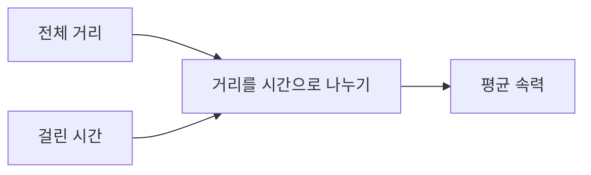

<!-- pi-doc-workflow template=0.2.0 audience=human -->
# Rules for `docs/`

These rules apply to knowledge articles, not to this instruction file.
Read this file explicitly before creating or editing any article in this folder.

## Purpose and reader

- This is the user's personal knowledge base: things they want to remember.
- The reader is a human viewing files in Obsidian, never an AI agent.
- Write only what the user should remember now. They can ask follow-up questions in chat.
- One idea per sentence, one point per paragraph, and one topic per section.

## When to write

- Write only when the user asks to add or update a note in `docs/`.
- Search for a note on the same topic before creating a file. Update it if it exists.
- Do not archive ordinary conversation or task completion automatically.

## File format

- Use `docs/<topic>.md` with a short Korean filename. Keep an English technical term when appropriate, such as `docs/DPS.md`.
- Start with YAML frontmatter. Use actual dates in `YYYY-MM-DD` format; preserve `created` and refresh `updated` when editing.

```yaml
---
title: <title>
created: YYYY-MM-DD
updated: YYYY-MM-DD
tags: [<tag>]
---
```

- After the frontmatter, write a `#` title followed immediately by a one-line summary: conclusion first.
- Split topics with `##` headings and link related notes using Obsidian `[[wikilinks]]`.

## Language and writing

- Write in Korean by default; use English only when the user requests it.
- Keep technical terms in their original form when clearer, with a Korean explanation on first use, such as `확산 모델(diffusion model)`.
- Define every abbreviation on first use.
- Aim for about 40-50 Korean characters per sentence, spaces included. Split chained clauses rather than counting obsessively.
- Keep prose paragraphs to about 300 characters at most, roughly 3-5 short sentences.
- Keep the whole article to 3,000 characters at most. Shorter is fine; there is no minimum length and no reason to add filler.
- Treat the length figures as approximate readability targets, not an excuse to omit essential conditions or make prose unnatural.
- Do not include XML tags, prompt-style instructions, agent activity logs, or "As an AI..." text in articles.

## Math and diagrams

- Use equations and diagrams when they explain faster than words; do not force irrelevant ones into a note.
- Use `$...$` for inline math and `$$...$$` for block math, compatible with Obsidian MathJax.
- Use fenced `mermaid` blocks for diagrams. Do not use images or ASCII art.
- Before every formula or diagram, write one sentence explaining what it shows.
- After a formula, define every symbol in a short list. State assumptions, units, and coordinate frames where relevant; check dimensions and explicitly identify frame or unit conversions.
- Explain diagram relationships and the meaning of arrows. Markup alone is not an explanation.

## Example of desired output

This is a short format example, not a required minimum length. Dates are placeholders to replace when writing a real note.

````markdown
---
title: 평균 속력
created: YYYY-MM-DD
updated: YYYY-MM-DD
tags: [운동, 속력]
---

# 평균 속력

> 평균 속력은 이동한 전체 거리를 걸린 시간으로 나눈 값이다.

## 계산

아래 식은 이동 전체를 하나의 속력 값으로 요약한다.

$$v = \frac{d}{t}$$

- $v$: 평균 속력, 단위는 $\mathrm{m/s}$
- $d$: 이동한 전체 거리, 단위는 $\mathrm{m}$
- $t$: 걸린 시간, 단위는 $\mathrm{s}$이며 $t > 0$

## 흐름

아래 그림의 화살표는 계산에 필요한 입력과 결과를 잇는다.



## 주의할 점

평균 속력은 이동 중 매 순간의 속력을 뜻하지 않는다.
````

## Accuracy and completion

- Do not invent facts, sources, or examples presented as observations. Cite a compact source link when a nontrivial claim needs support.
- If research or code inspection does not settle a point, state that it is unknown.
- Preserve existing notes and project-specific rules. Never move an agent document here without rewriting it for a human reader.
- After writing, tell the user the file path and a one-line summary.
